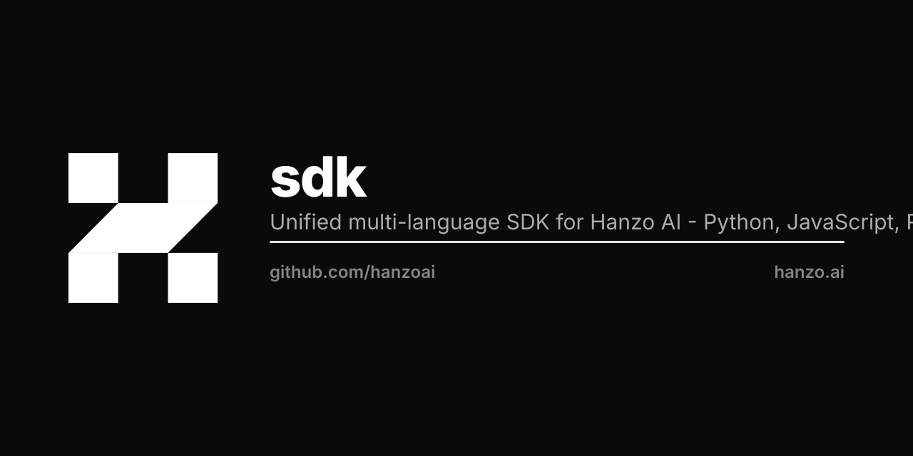

<p align="center"></p>

# Hanzo AI SDKs

[](https://github.com/hanzoai/sdk/actions/workflows/conformance.yml)
[](spec/openapi.json)
[](LICENSE)
[](https://api.hanzo.ai)

The central repository and conformance specification for all **Hanzo AI SDKs**.

Hanzo provides two distinct, complementary tiers across every major programming language:

1. **Full Cloud SDKs**: Complete, typed projections of the entire Hanzo Cloud platform (over 2,400 operations covering models, agents, compute, storage, datastore, IAM, billing, chain, and networking).
2. **AI & Agents Flagship SDKs**: Ergonomic, hand-crafted libraries tailored specifically for foundation models, streaming inference, agent orchestration, tool calling, memory architectures, MCP (Model Context Protocol), and the **Kai Agent Governance & Behavioral Policy Engine**.
3. **CLI & Developer Utilities**: Unified terminal workflows via [`hanzoai/cli`](https://github.com/hanzoai/cli) and [`hanzo.sh`](https://hanzo.sh).

---

## SDK Matrix

| Language / Platform | Tier | Package | Installation | Repository | Docs |
| :--- | :--- | :--- | :--- | :--- | :--- |
| **Python** | Cloud & AI Flagship | `hanzoai` / `hanzo` | `pip install hanzoai` | [hanzoai/python-sdk](https://github.com/hanzoai/python-sdk) | [Python Docs](https://docs.hanzo.ai/docs/sdks/python) |
| **TypeScript / Node** | Cloud & AI Flagship | `@hanzo/sdk` / `@hanzo/ai` | `npm install @hanzo/sdk` | [hanzo-js/sdk](https://github.com/hanzo-js/sdk) · [hanzoai/js-sdk](https://github.com/hanzoai/js-sdk) | [TypeScript Docs](https://docs.hanzo.ai/docs/sdks/typescript) |
| **Go** | Cloud & AI | `github.com/hanzoai/go-sdk` | `go get github.com/hanzoai/go-sdk` | [hanzo-go/sdk](https://github.com/hanzo-go/sdk) | [Go Docs](https://docs.hanzo.ai/docs/sdks/go) |
| **Rust** | AI & Agents / Cloud | `hanzo-client` / `hanzo` | `cargo add hanzo-client` | [hanzo-rs/sdk](https://github.com/hanzo-rs/sdk) | [Rust Docs](https://docs.rs/hanzo-client) |
| **PHP** | Cloud API | `hanzoai/hanzoai` | `composer require hanzoai/hanzoai` | [hanzo-php/sdk](https://github.com/hanzo-php/sdk) · [hanzoai/php-sdk](https://github.com/hanzoai/php-sdk) | [PHP Docs](https://docs.hanzo.ai/docs/sdks/php) |
| **Ruby** | Cloud API | `hanzoai` | `gem install hanzoai` | [hanzo-ruby/sdk](https://github.com/hanzo-ruby/sdk) · [hanzoai/ruby-sdk](https://github.com/hanzoai/ruby-sdk) | [Ruby Docs](https://docs.hanzo.ai/docs/sdks/ruby) |
| **Dart / Flutter** | Cloud & Mobile | `hanzoai` | `dart pub add hanzoai` | [hanzo-dart/sdk](https://github.com/hanzo-dart/sdk) · [hanzoai/dart-sdk](https://github.com/hanzoai/dart-sdk) | [Dart Docs](https://docs.hanzo.ai/docs/sdks/dart) |
| **Java** | Cloud (typed client) | `ai.hanzo:hanzo-java-cloud` | Gradle / Maven | [hanzo-java/sdk](https://github.com/hanzo-java/sdk) · [hanzoai/java-sdk](https://github.com/hanzoai/java-sdk) | [Java Docs](https://docs.hanzo.ai/docs/sdks/java) |
| **Kotlin** | Cloud & Agents | `ai.hanzo:hanzo-kotlin-cloud` | Gradle / Maven | [hanzo-kotlin/sdk](https://github.com/hanzo-kotlin/sdk) | [Kotlin Docs](https://docs.hanzo.ai/docs/sdks/kotlin) |
| **Swift** | Cloud & Async/Await | `Hanzo` | SwiftPM (tag `v8.0.0`) | [hanzo-swift/sdk](https://github.com/hanzo-swift/sdk) | [Swift Docs](https://docs.hanzo.ai/docs/sdks/swift) |
| **C++** | Native Bindings | `hanzo::hanzo` | CMake `FetchContent` | [hanzo-cpp/sdk](https://github.com/hanzo-cpp/sdk) | [C++ Docs](https://docs.hanzo.ai/docs/sdks/cpp) |
| **C# / .NET** | Cloud API | `Hanzo.AI` | `dotnet add package Hanzo.AI` | [hanzoai/csharp-sdk](https://github.com/hanzoai/csharp-sdk) | [C# Docs](https://docs.hanzo.ai/docs/sdks/csharp) |
| **Web Fetch** | Browser / Edge | `@hanzo/sdk-fetch` | `npm install @hanzo/sdk-fetch` | [hanzo-js/sdk-fetch](https://github.com/hanzo-js/sdk-fetch) | [Fetch Docs](https://docs.hanzo.ai/docs/sdks/fetch) |
| **Angular** | Frontend Angular | `@hanzo/sdk-angular` | `npm install @hanzo/sdk-angular` | [hanzo-js/sdk-angular](https://github.com/hanzo-js/sdk-angular) | [Angular Docs](https://docs.hanzo.ai/docs/sdks/angular) |
| **Hanzo CLI** | Terminal & Automation | `hanzo` | `curl -fsSL https://hanzo.sh \| sh` | [hanzoai/cli](https://github.com/hanzoai/cli) | [CLI Docs](https://docs.hanzo.ai/docs/cli) |

### Ecosystem Organization Architecture

- **Dedicated Language Orgs**: Each major ecosystem has its own dedicated GitHub organization (`hanzo-php`, `hanzo-ruby`, `hanzo-go`, `hanzo-js`, `hanzo-rs`, `hanzo-py`, `hanzo-swift`, `hanzo-kotlin`, `hanzo-cpp`, `hanzo-dart`). Real code lives in `hanzo-<lang>/sdk`.
- **Public Package Mirrors**: The `hanzoai/*-sdk` repositories under `hanzoai` act as public mirrors and landing redirects.
- **Go Import Resolution**: The Go module import path is `github.com/hanzoai/go-sdk` while the repository sits at `hanzo-go/sdk`. Go modules resolve by module path, not repo URL.
- **PHP Packagist**: The PHP SDK is officially published on Packagist as [`hanzoai/hanzoai`](https://packagist.org/packages/hanzoai/hanzoai) from [`hanzo-php/sdk`](https://github.com/hanzo-php/sdk).
- **RubyGems**: The Ruby SDK is published on RubyGems as [`hanzoai`](https://rubygems.org/gems/hanzoai) from [`hanzo-ruby/sdk`](https://github.com/hanzo-ruby/sdk).
- **Dart Pub**: Published on pub.dev as [`hanzoai`](https://pub.dev/packages/hanzoai) from [`hanzo-dart/sdk`](https://github.com/hanzo-dart/sdk).

---

## Universal API Contract & Configuration

Every official Hanzo SDK speaks the same HTTP/REST and SSE wire protocols:

### Environment Variables

| Variable | Default Value | Description |
| :--- | :--- | :--- |
| `HANZO_API_KEY` | *(Required)* | Secret API key (`sk-...`) or frontend publishable key (`pk-...`). |
| `HANZO_BASE_URL` | `https://api.hanzo.ai/v1` | Root API gateway endpoint. |
| `HANZO_ORG_ID` | `None` | Optional tenant / organization identifier (`X-Hanzo-Org` header). |
| `HANZO_MODEL` | `zen5` | Default frontier model ID. |
| `HANZO_TIMEOUT` | `60` | HTTP request timeout in seconds. |
| `HANZO_MAX_RETRIES`| `3` | Maximum retry attempts for 429/5xx status codes with exponential backoff. |

### Model Catalog (Zero Credential Route)

The model catalog is identical for all callers and requires no authentication token:

```bash
curl https://catalog.hanzo.ai/v1/models
# or
curl https://api.hanzo.ai/v1/models
```

Recommended frontier models:
- **`zen5`**: Flagship frontier reasoning model.
- **`zen5-coder`**: Specialized high-efficiency coding and architecture model.
- **`enso`**: Lightweight, ultra-low latency model for high-frequency agent actions.
- **`zen-embed`**: 1536-dimensional dense vector embeddings.

### Kai Agent Governance & Decision API

Kai provides explicit policy evaluation and behavioral consistency benchmarking for autonomous agents:

```http
POST /v1/decisions
Content-Type: application/json
Authorization: Bearer sk-...

{
  "agent_id": "agent-support-01",
  "policy_id": "pol-financial-safety-v2",
  "action": {
    "type": "execute_transaction",
    "payload": { "amount": 25.00, "currency": "USD" }
  },
  "context": { "user_authenticated": true }
}
```

Verdict replies: `ALLOW`, `DENY`, or `MODIFY` with deterministic confidence scores and reasoning audits.

---

## Conformance Specification & Test Harness

This repository holds the canonical OpenAPI 3.1 specification and automated test fixtures to ensure 100% cross-language behavioral compatibility:

- **`spec/openapi.json`**: Official OpenAPI 3.1 specification for `/v1`.
- **`conformance/fixtures/`**: Wire test vectors for authentication headers, unary chat completions, SSE streaming events, tool calling, embeddings, Kai decisions, and error envelopes.
- **`conformance/runner.py`**: Self-contained Python test harness and local mock server.

### Running the Conformance Suite Locally

```bash
# Validate all fixtures, OpenAPI schema, and run wire tests against the mock gateway
python3 conformance/runner.py --validate-all

# Spin up a standalone local mock gateway on port 8080 for testing any language SDK
python3 conformance/runner.py --server --port 8080
```

---

## Quickstart Examples

### Python

```python
from hanzoai import Hanzo

client = Hanzo()

# Chat Completion
response = client.chat.completions.create(
    model="zen5",
    messages=[{"role": "user", "content": "Hello Hanzo!"}]
)
print(response.choices[0].message.content)
```

### TypeScript / JavaScript

```typescript
import { Hanzo } from '@hanzo/ai';

const client = new Hanzo();

const response = await client.chat.completions.create({
  model: 'zen5',
  messages: [{ role: 'user', content: 'Hello Hanzo!' }],
});
console.log(response.choices[0].message.content);
```

### Go

```go
package main

import (
    "context"
    "fmt"
    "github.com/hanzoai/go-sdk"
)

func main() {
    client := hanzo.NewClient()
    resp, _ := client.Chat.CreateCompletion(context.Background(), hanzo.ChatCompletionRequest{
        Model: "zen5",
        Messages: []hanzo.ChatMessage{{Role: "user", Content: "Hello from Go!"}},
    })
    fmt.Println(resp.Choices[0].Message.Content)
}
```

### PHP

```php
<?php
require_once __DIR__ . '/vendor/autoload.php';

use Hanzo\Client;

$client = new Client();
$reply = $client->chat->completions->create([
    'model' => 'zen5',
    'messages' => [['role' => 'user', 'content' => 'Hello from PHP!']]
]);
echo $reply['choices'][0]['message']['content'] . "\n";
```

### Ruby

```ruby
require 'hanzoai'

client = Hanzoai::Client.new
reply = client.chat.completions.create(
  model: 'zen5',
  messages: [{ role: 'user', content: 'Hello from Ruby!' }]
)
puts reply.choices.first.message.content
```

### Rust

```rust
use hanzo_client::{Client, ChatMessage, Role};

#[tokio::main]
async fn main() -> Result<(), Box<dyn std::error::Error>> {
    let client = Client::from_env();
    let reply = client.chat().create_completion("zen5", vec![
        ChatMessage { role: Role::User, content: "Hello from Rust!".into() }
    ]).await?;
    println!("{}", reply.choices[0].message.content);
    Ok(())
}
```

*(See [`examples/`](examples/) for complete standalone scripts in Go, Rust, Python, PHP, Ruby, Dart, and cURL).*

---

## Documentation & Resources

- [Official Documentation](https://docs.hanzo.ai/docs/sdks)
- [API Reference](https://api.hanzo.ai)
- [API Key Management](https://hanzo.ai/account/keys)
- [Kai Decision Engine & Behavioral Governance](https://docs.hanzo.ai/docs/kai)

---

## Company & Support

Hanzo AI is co-led by Co-CEOs **Antje Worring** and **Zach Kelling**.

- **Corporate Address**: 995 Market St, San Francisco, CA 94103
- **Inquiries & Support**: [dev@hanzo.ai](mailto:dev@hanzo.ai) · [support@hanzo.ai](mailto:support@hanzo.ai)

---

## License

Licensed under the [Apache License, Version 2.0](LICENSE) or the [MIT License](LICENSE) at your option.
